# 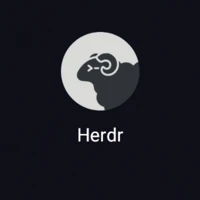 Herdr for Android

A native Android client for [herdr](https://herdr.dev) hosts: see your agents across machines, answer the blocked ones, and open any pane as a live terminal. Kotlin and Jetpack Compose. It wears the Herdr desktop's `workbench` look (an engineering-puzzle-game console: near-black panels, amber frames, numbered space slots, chip-package icons, dot-matrix glyphs; paper and dark amber in light mode), flat and square, laid out as Shepherdr 3.1's phone web app: a drawer of spaces and a bottom bar of Chat, Tasks and Artifacts ([`docs/DESIGN.md`](docs/DESIGN.md)).

<table>
  <tr>
    <td align="center" width="25%">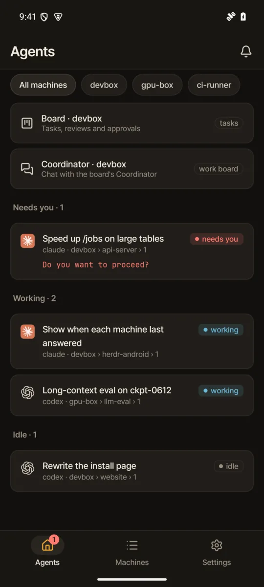<br><sub><b>Agents</b>: what needs you on every machine first, answerable on the card</sub></td>
    <td align="center" width="25%">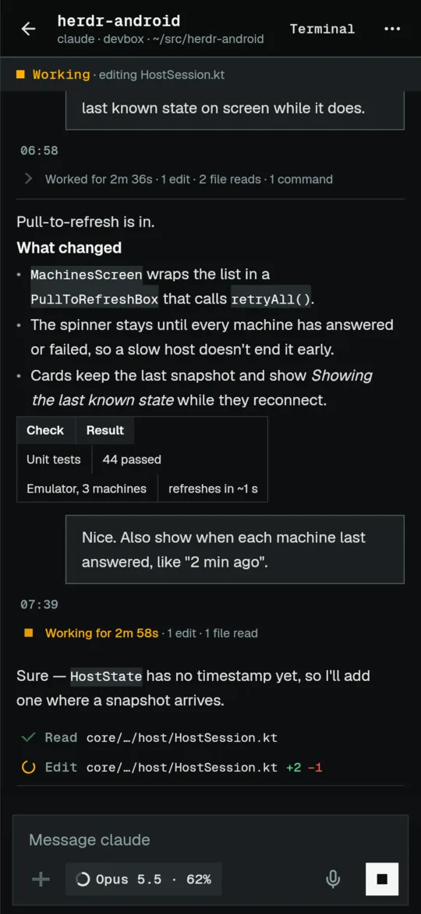<br><sub><b>Agent chat</b>: the agent's own transcript, each turn's work folded to one line</sub></td>
    <td align="center" width="25%">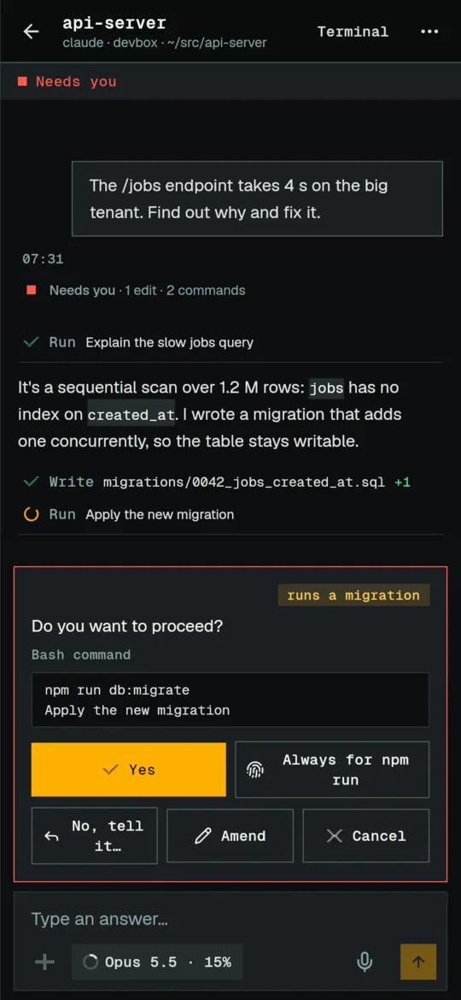<br><sub><b>Needs you</b>: the question docked over the composer, answered with a thumb</sub></td>
    <td align="center" width="25%">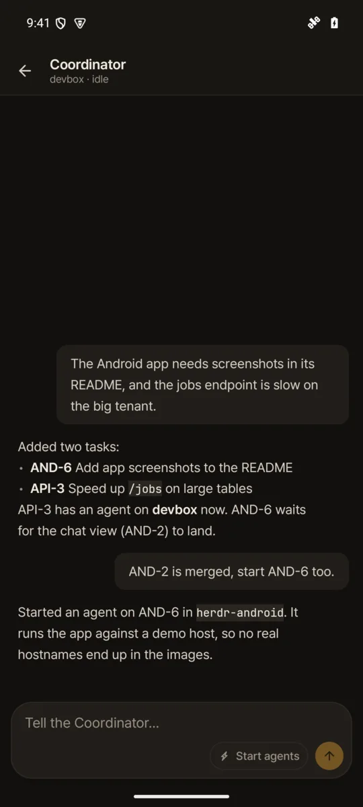<br><sub><b>Coordinator</b>: talk to the work board</sub></td>
  </tr>
  <tr>
    <td align="center">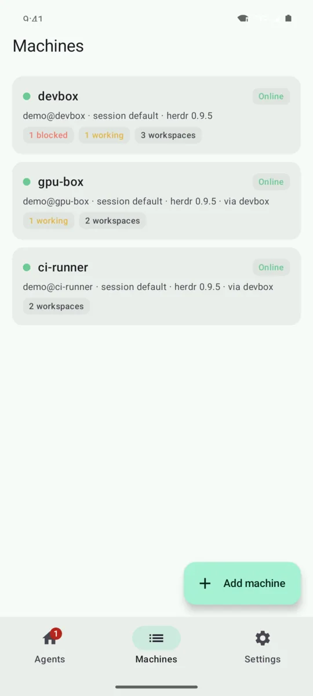<br><sub><b>Machines</b>: status per host, also through a jump host</sub></td>
    <td align="center">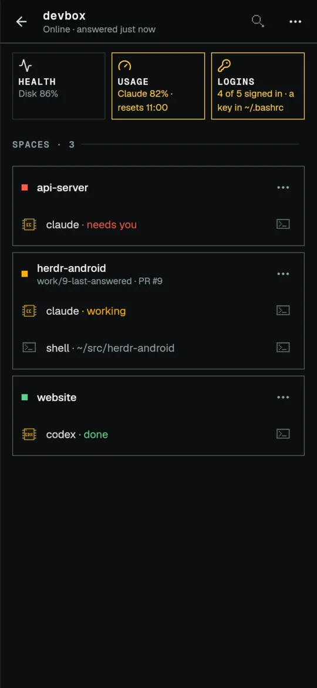<br><sub><b>A machine</b>: its workspaces, tabs and panes</sub></td>
    <td align="center">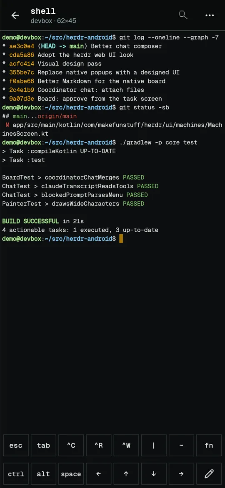<br><sub><b>Terminal</b>: any pane, live, sized to the phone</sub></td>
    <td align="center">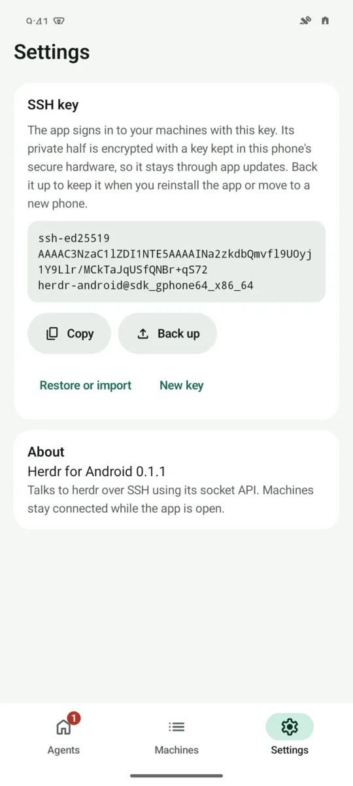<br><sub><b>Settings</b>: the SSH key, with backup and restore</sub></td>
  </tr>
  <tr>
    <td align="center">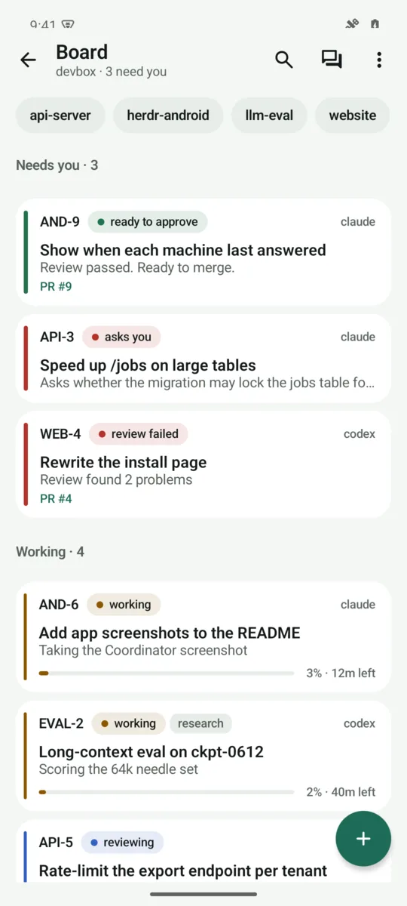<br><sub><b>Board</b>: tasks in the board's colours, the ones that need you first</sub></td>
    <td align="center">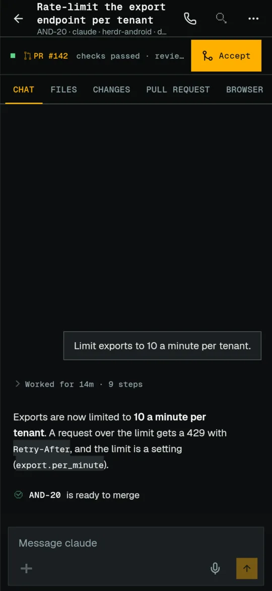<br><sub><b>A task</b>: next step, reviews, links, one tap to approve</sub></td>
    <td align="center">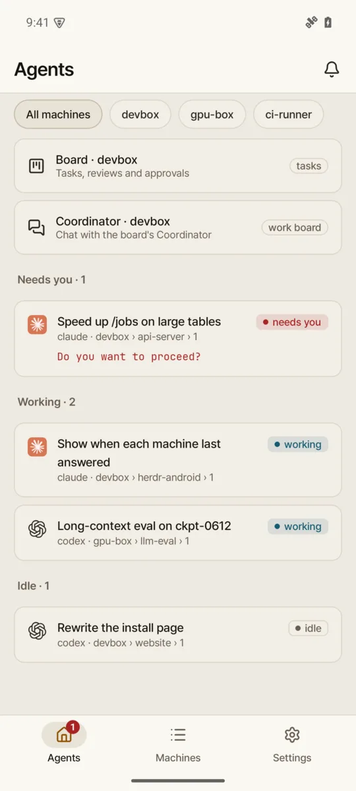<br><sub><b>Light mode</b>: follows the phone</sub></td>
    <td align="center">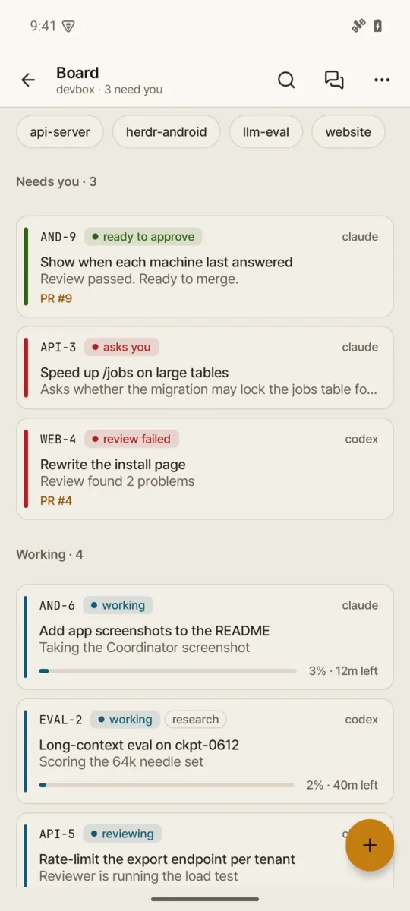<br><sub><b>Board, light</b></sub></td>
  </tr>
</table>

The screenshots come from a demo host with made-up projects (see [`docs/screenshots/demo-host`](docs/screenshots/demo-host)). The look (colours, type, icons, spacing, components) is described in [`docs/DESIGN.md`](docs/DESIGN.md); the theme and art are the Herdr desktop's workbench (Apache 2.0), and the fonts and icons are credited in [`THIRD_PARTY_NOTICES.md`](THIRD_PARTY_NOTICES.md).

## Getting the app

On your phone, open the repo's [latest release](https://github.com/makefunstuff/herdr-android/releases/latest) and tap **herdr-android.apk** (the direct link is `https://github.com/makefunstuff/herdr-android/releases/latest/download/herdr-android.apk`). Android asks you once to allow installs from your browser or file manager.

To update, do the same again: every build is signed with the same key and has a higher version code, so it installs over the app you have and keeps its machines and SSH key. No uninstall needed.

Only the default branch publishes a release (tagged `v0.1.<run number>`). Other branches and pull requests build the APK too, as the `herdr-android-<run number>` artifact on their Actions run page, without a release.

## Keeping the SSH key

The key stays through updates. An uninstall or a new phone wipes it, so back it up first: **Settings → SSH key → Back up** saves it as an OpenSSH private key protected by a passphrase you choose (`ssh-keygen -y -f herdr-android-key` reads it too). After a reinstall the app offers **Restore or import** before it makes a new key; the same button is in Settings. It also takes an existing OpenSSH (or PEM) private key, with or without a passphrase.

The app never replaces a key on its own: it only makes one when it has none and you ask for it, and **New key** asks before throwing the old one away.

## Signing key (once, for the repo owner)

Releases must all be signed with one key, or Android refuses the update. Create it once and keep a copy somewhere safe; losing it means everyone has to uninstall (and restore their SSH key backup) once.

```sh
keytool -genkeypair -keystore herdr-release.jks -alias herdr \
  -keyalg RSA -keysize 4096 -validity 10000 -dname "CN=Herdr for Android"
base64 -w0 herdr-release.jks > herdr-release.jks.b64
```

Then add these secrets under **Settings → Secrets and variables → Actions** (or with `gh secret set NAME`):

| Secret | Value |
| --- | --- |
| `HERDR_KEYSTORE_BASE64` | contents of `herdr-release.jks.b64` (`gh secret set HERDR_KEYSTORE_BASE64 < herdr-release.jks.b64`) |
| `HERDR_KEYSTORE_PASSWORD` | the keystore password |
| `HERDR_KEY_ALIAS` | `herdr` |
| `HERDR_KEY_PASSWORD` | optional: the key password, only if it differs from the keystore password (keytool uses the same one by default) |

Without these secrets, and for local builds, the APK is signed with the normal debug key and the default branch skips publishing a release (and keeps the old `apk-*` pre-releases until the first real one). To sign a local build with the real key, set `HERDR_KEYSTORE_FILE`, `HERDR_KEYSTORE_PASSWORD` and `HERDR_KEY_ALIAS` and run `./gradlew :app:assembleRelease`.

## Setting up a machine

**By its code**, with nothing to copy or type:

1. On the machine running herdr, run `herdr-push pair`. A machine the app already set up for notifications has it in `~/.local/share/herdr-push/`; elsewhere (or where that one is older and doesn't know `pair`), fetch it:
   ```sh
   curl -fsSLO https://raw.githubusercontent.com/makefunstuff/herdr-android/HEAD/host/herdr-push/herdr-push
   python3 herdr-push pair
   ```
   It shows a QR code with where the machine is (its Tailscale name and address, its address on the local network), its user, its SSH host key's fingerprint and a one-time code, valid five minutes.
2. In **Machines**, tap **Add machine**, then **Scan the code**. The phone's own code scanner reads it (Google Play services': the app asks for no camera permission). Without one, **Paste the link** takes the link printed under the code.
3. The app finds the machine at the first address that answers with that host key and shows what it found. **Pair and add** logs in with the one-time code, which can do nothing but hand over this phone's public key: it goes into `~/.ssh/authorized_keys` there, the code is spent, and the app pins the host key and opens the machine.

How it works and what it touches: [`host/herdr-push/README.md`](host/herdr-push/README.md#pairing-a-phone).

**By hand** (**Add machine → Type the address instead**):

1. Open **Settings** (the gear in the Machines bar) and copy the app's public key.
2. Add it to `~/.ssh/authorized_keys` on the machine running herdr.
3. In **Machines**, tap **Add machine**, then **Type the address instead**, and enter `user@host[:port]`. The app pins the host key on first connect.

Machines reachable only through another one can use it as a jump host ("Connect through"). For zero-touch or read-only machines, **Allow host scripts** (on by default) can be turned off so the app skips copying its helper scripts (`herdr-usage`, `herdr-logins`, `herdr-push`) there. From a machine's menu, **Import herdr machines** adds the machines its herdr already knows (`herdr machine list`).

## How it talks to herdr

The app opens an SSH connection and reaches herdr's socket API through `direct-streamlocal` (falling back to `herdr remote-api-bridge`). herdr answers one request per socket connection, so each call opens a fresh channel; `events.subscribe` keeps one channel open for live updates. Terminals use `herdr terminal session control`.

## Needs you, first

The **Agents** screen opens with one **Needs you** list across every machine: agents asking a question, Shepherdr tasks waiting for you (Ready to accept, or asking), and Assistants that ask. An agent and the task it works on show once, as one card (the app ties them by the task Shepherdr labels its terminal with, or the workspace it opens for the task). Each card carries its answers:

- a question: **Yes** and **No** (or the menu's two choices), and **Reply**. Like a notification's buttons, Yes and No read the agent's screen again first and press nothing if the question changed; a longer menu opens in the chat.
- a task: its question card's choices, or **Accept** for one that is Ready (Shepherdr's Accept card first), and **Open**, its chat on the board.

Below it, the agents at work are one line each, with a thin bar. Finished ones wait under **Done** until you open their chat on the phone, swipe them right, press **Mark all seen**, or look at their pane in herdr itself (herdr then says idle; the app reads its `completion_seq` to tell one finish from the next); a finish seen rests with the idle ones.

Swipe an agent left for **Pin** (it stays on top, under Needs you, in the order pinned; kept on the phone, and gone when the pane is). Its long-press sheet has Pin too, and its space's **Notify**: **All** (its questions and each finish), **Needs me** (only its questions) or **Off** (nothing: no alerts, no Live Update while it works, no in-app alert; its rows show a crossed-out bell). The same choice is a long press on the space in the drawer, as in Shepherdr 3.1. A space that picks nothing follows the switches in Settings (Needs me by default). A question always shows in Needs you, whatever its space's Notify. Mutes and watches from before Notify move onto their spaces the first time the app reads their machine: a muted agent's space becomes Off, a watched one's All. One line on top says how many machines are online and filters the list to one. **Ask** opens the Coordinator: the one used last, or it asks which machine. The tabs are **Agents**, **Board** and **Machines**, each badge counting what waits for you; Settings is the gear in the Machines bar. The boards are read every 15 seconds while the list is in front (every 10 on the Board tab).

## Search

The search icon on **Agents**, **Board** and a machine (or **Ctrl+K** with a hardware keyboard, from anywhere) opens one box for the agents, the boards' tasks, the machines, their workspaces and the words in the recent chats. Chips above the results filter them to what **Needs you**, what is **Working** and what is **Done**, each with its count. From a machine it searches only that machine, until its chip is taken off. Every word typed has to be in a result, and a word at the start of a name counts most; with nothing typed it lists the agents, the tasks waiting for you and **Start work…**.

Words in the chats are looked for on the machines themselves: each running agent's own transcript (Claude Code, codex, pi and omp) is searched where it is, a moment after you stop typing (three letters at the least), and what was said around the words shows with who said it and when; tool calls and their output don't count. Under the results, **New task about "…"** starts work about the words, and **Open a terminal in …** opens a shell in the workspace found (each workspace row has the same terminal button). Enter opens the first result, Esc goes back.

## Start work

**Start work** asks first what you want, then how and where. It opens from a long press on **Ask** (or the **Start work** button when no machine has the work board), from the search, and from the launcher's shortcut.

- **Board task**: the sentence becomes a task on the chosen machine's board (its first line the title, the rest the description), in one of the board's repos or a folder, with a worktree, checks and a review; the board picks its agent (shown, with what is left of its limit), at once or later.
- **Agent now**: an agent starts in the folder, in a new tab of the workspace that sits there (else a workspace of its own), named after the sentence's first words, and the sentence is its first message. The agents offered are the ones installed on that machine: those herdr's integrations find, and every other kind herdr can start whose program is on the machine's PATH (gemini, amp…).

The folders offered are the ones work was started in from the phone, then the workspaces' (a task's worktree counts as its repository); **Browse…** walks the machine's folders, Git repositories marked. The phone never starts an agent in a mode that skips its permission prompts: it asks before it acts, as it does at the desk. A machine's **New › Agent** sheet has the same first-message field, lists the agents installed there, and starts the agent in a new split beside the workspace's focused pane.

## Managing from the phone

A machine's screen opens with its places as tiles in one row, each with a live line: **Board** (how many tasks need you, else how many are at work), **Coordinator** (idle, working, waits for you) and **Health**; **Usage** is a line under them (a tile on a machine without the board). Its workspaces follow, each with its branch and pull request under its name and one row per pane: the agent and its state, or the shell and its folder, a tap opening its chat (or terminal) and the terminal icon its terminal. Tab chips and the layout thumbnail show only for a workspace with several tabs. The bar says when the machine last answered ("Online · answered 4 s ago").

Everything that exists in a session is editable from the app, not just readable. A workspace or tab header has an actions button (a workspace's one tab is under its actions, **Its tab**), and panes and agents answer to a long press: rename, focus, reorder, move, swap, zoom, clear a pane's scrollback, read what a pane is running, and ask `agent.explain` why an agent is in the state it shows. Closing a workspace, tab or pane asks first. herdr's own refusals ("There's no pane in that direction.") come back as plain sentences.

The screens follow herdr's `events.subscribe` stream, so a change made anywhere — desktop or phone — appears here. Notifications are the exception: herdr has no list of them, so the app derives them from agents finishing or blocking and shows them behind the bell in the top bar; the menu can also show a notification on the desktop running herdr.

## The terminal

Any pane opens as a live terminal, sized to the phone.

- **The key bar** over the keyboard has two rows of keys on a phone: Esc, Tab, ^C, ^R (the shell's history), ^W (delete a word), `|`, `~`, **fn** (a page of F1 to F12, Page Up and Down), Ctrl, Alt, Space and the arrows. Ctrl, Alt and Shift are sticky: a tap holds one for the next key (the bar's or the keyboard's: Ctrl then ← is a word back), a second tap keeps it on (underlined) until a third. **Hold Space and drag** to move the cursor: a cell for each 12 dp across, a line for each 24 dp up or down.
- **Your own keys.** The pencil at the end of the bar (or **⋯ → Edit key bar…**) lists the bar's keys, each moved earlier or later or taken off, and offers more by kind: modifiers and pages (Shift, the keyboard key), shortcuts (^D, ^Z, ^L, ^A, ^E, ^U, ^K, ^B, Alt+B, Alt+F, Alt+., Shift+Tab), keys (Enter, Backspace, Delete, Home, End, Page Up and Down…) and characters; a tap puts a key on the bar or takes it off. **A shortcut of your own** builds any other: Ctrl, Alt and Shift with a letter, a sign or a key's name (`F5`, `Home`, `Left`). **Back to the first keys** undoes it all. The bar is the phone's, the same in every terminal, and stays through restarts.
- **Selected text** (a long press, or **⋯ → Select text**, then a drag) gets **Copy**, **Quote in chat** and **Send to Coordinator**. Quoting puts it in a fenced block, with where it came from (`From the terminal (shell on devbox):`), at the end of an agent's message box and opens its chat: the workspace's agent, or the one you pick when there are several. **Send to Coordinator** puts it in the machine's Coordinator chat the same way (on a machine with the board). Nothing is sent until you send it.
- **Keep screen on** (the sun in the bar, or the **⋯**): the screen stays on while a terminal is open, for a long build or a log you follow. It is kept for every terminal until turned off.

## Reading a chat

An agent's chat is its own transcript (Claude Code's, codex's, pi's or omp's), cut to fit a phone that shows about fifteen lines:

- **One line per turn's work**, as in the herdr web UI: everything the agent did between your message and its answer (the calls, its words on the way) folds under **Worked for 2m 36s · 1 edit · 2 file reads · 1 command** once the turn is over, and the answer stays out of the fold. Calls that failed are counted apart, in red (**· 1 failed**), since the fold hides their rows. A tap opens or folds it again, and it stays as you left it. The turn at work is open, headed **Working for 3m** (or **Needs you** while it asks); a turn whose last words came before its last call stays open, so nothing it said is hidden.
- **A time on each turn**: `10:05`, or `Oct 16, 09:12` on another day.
- **Short paths**: a file in the repo shows from it, deep ones as `core/…/host/HostState.kt`, and an edit says what it changed (`+12 −2`). A tap on a row still shows the whole call and what it printed.
- **One Working line**: the strip under the bar says what the newest turn is at (*Working · editing HostState.kt*) and the turn's own header how long it has worked (*Working for 3m 12s*), so there is no second "Working" at the bottom.
- **While you were away**: coming back to a chat after five minutes or more, a card says what happened since it was last on screen, in up to three lines from the transcript (what the agent answered, what it was asked and what it is at, the files it changed with `+61 −8`, the commands it ran and whether the tests passed). It goes when you write, or with **Hide**. "Last on screen" is kept per chat on the phone: when you left it, or put the app away while it was open.
- **"2 new messages"**: read further up while the agent writes, and a pill counts what came in; a tap goes to the newest (with nothing new, the round arrow does).

The times, kinds, failures and edits come from the same reading of the agent's session as the activity timeline (below); a transcript without times still folds its turns, without durations or times.

## Writing to an agent

The composer knows the agent it writes to:

- **Held messages**: what you send while the agent works isn't typed into its screen in the middle of its turn. It waits over the composer, *Held until claude is ready*, with **Send now** (it goes at once, as the agent's next words) and **X** to discard it. Nothing held goes by itself: once the agent is done the line says *claude is ready: review and send*, in amber. Held messages are kept per chat on the phone, through restarts; while the agent asks something they fold to their caption, and Send now waits for the answer.
- **Quick replies**: one-tap chips over an empty box, *continue*, *commit and push*, *run the tests*. Off until **Settings → Quick replies** turns them on; there (or from the pencil at the chips' end) you edit, add or remove them. A chip sent while the agent works is held like anything typed.
- **`/` and `@`**: a `/` at the start of the message lists the agent's own commands (Claude Code's `/compact`, `/review`, `/model`…, codex's, pi's and omp's), with your own and the project's commands and skills read on its machine (`~/.claude/commands`, `.claude/commands` in its folder, the skills folders; codex's saved prompts; pi's prompts and skills). `@` completes a file in the agent's folder: Git's files there (or a walk of the folder when it isn't a checkout), listed once over SSH, matched as you type. A tap puts it in the message.
- **Talk to type**: a tap on the mic beside Send listens, and **Done** (✓, in Send's place) puts what you said into the box where the cursor was, to edit and send; the **X** drops it. While it listens the box shows how loud you are and, with the phone's recogniser, the words as they come. Where the chat's machine runs Shepherdr 3 with whisper.cpp (`shepherdr whisper`), the phone records (AAC, `audio/mp4`) and the machine writes it down (`POST /api/dictate`, as 3.1's web app does; asked once every 10 minutes per machine with an empty recording); elsewhere Android's own speech recogniser does, on the phone where it can (on-device on Android 12 and later). It stops by itself after 5 minutes. Failures are logged under the tag `HerdrDictate`.
- **Voice messages**: holding the mic records what you say and sends the recording itself to the agent; the phone turns nothing into text. Hold it while you speak and let go to send (slide left to cancel); TalkBack's **Record a voice message** action on the mic starts one hands-free, sent with Send; the box shows how loud you are and the time, and the draft you typed stays as it was. The audio is AAC in an `.m4a` file (about 360 KB a minute, at most 10 minutes; under a second is dropped as too short). For a herdr agent it is copied over SSH to `~/.cache/herdr-android/uploads/<stamp>/voice-message-0m07s.m4a` on its machine and named to the agent as an `@path` mention, the way an attached file goes (held like typed words while the agent works); on Shepherdr it is kept by its service (`/api/upload`) and goes to the space's Assistant as a file sent in its chat, its path after the words. The agent's own program gets the file: Claude Code, Codex and pi can't listen to audio today, so the agent sees a voice message's file and its length but not what you said, unless it has its own way to transcribe it on the machine. In the chat it is a voice bubble with play, its length, and how far along while it plays; one that couldn't be copied or sent stays on the phone with why, and goes again when the chat opens, when the machine comes back, or on **Retry** (or **Discard**). The microphone is asked for the first time you touch the mic, with a line saying why; refused, the composer says so and offers **Allow** (or the phone's settings, once Android won't ask again). Recording and failures are logged under the tag `HerdrMic`. The Assistant on Shepherdr has the same mic.
- **The model pill**: beside **+**, *Opus 5.5 · 62%* is the model the agent answers with and how full its context is, with a ring (amber past 80%). It comes from herdr's own fields for the agent (an integration that reports `model` and `context` in its `tokens`) or else the transcript: the model and the tokens its last request filled, of the window Codex states or Claude's usual 200k (1M once a request went past that). A tap shows the details (the tokens, the window, the reasoning level, the model's id, what herdr reports about the agent) and **Usage and limits**, the machine's provider page, with what the agent's provider has left.

## Answering a blocked agent

In an agent's chat, the question a blocked agent asks is docked over the composer, so it never scrolls away with the transcript, and it is made for one thumb:

- **The choices are buttons**: **Yes** first and filled; a permanent allow ("Yes, and don't ask again for npm run commands") as **Always for npm run**, which asks for the fingerprint first (below); **No, tell it…** opens the reply, and the no is pressed only when your words go, which then become the agent's next prompt (X takes it back and the question stays).
- **The agent's footer is buttons too**: "Esc to cancel · Tab to amend" becomes **Amend** (presses Tab, then what you type is added to your answer) and **Cancel** (Esc); other keys it names (`ctrl+e to explain`) get their own.
- **A tag says what it would do**: *runs a migration*, *pushes*, *installs packages*, *edits a file*, in red when it can't be taken back (*deletes files*, *force-pushes*, *discards changes*, *deletes data*).
- **Claude's own questions** (its AskUserQuestion form) list each option with its description and a *Recommended* tag; your own words go in the composer. A multiple choice has boxes and **Submit (n)**; a form of several questions shows its steps as chips (✓ answered, the one asked now, Submit).
- Every press reads the agent's screen again first and presses nothing if the question, or the command it is about, changed; so do the notification buttons and the Needs you cards. While you type, the card folds to one line.

## Fingerprint and app lock

**Settings → Fingerprint and app lock** asks for the fingerprint (or face, or the phone's PIN) before what can't be undone, each one switchable: **Always allow** on an agent's question, **Approve and merge** (also "Approve anyway", and on a Needs you card), **Stop a process** (and the leftovers, and Gradle daemons, on a machine's health), **Remove a worktree**, and **Replace the SSH key** (a new key, or restoring another). Every one asks until you turn it off, and turning one off asks too. A notification's **Approve and merge** or permanent allow opens the prompt over whatever is on screen before it does anything.

**App lock** makes opening the app ask as well (it holds the SSH key to every machine), again after it was away for a while (at once, 1, 5 or 15 minutes), keeps its picture out of the recent apps, and makes a locked phone show its notifications only as "Something needs you", without the question, the command or the buttons. A phone with no screen lock has nothing to ask with: the screen says so, the app lock stays off, and the one-tap actions (always allow, merges) ask for a tap on **Confirm** instead.

## Machine health and cleanup

A machine's screen has a **Health** tile (the busiest of RAM, CPU and its fullest disk, red when it runs low), and **⋯ → Health and cleanup** opens the whole picture, read over the same SSH connection every 5 seconds while the screen is in front:

- **RAM, swap, CPU and every disk** (free space per mount), and a chart of RAM and CPU over the **last hour**. The hour comes from herdr-push, which notes a reading every 30 seconds on the machine; without it the chart fills while the screen is open.
- **The biggest processes** by memory or CPU, each with what it is and whose: Android emulators (with their AVD), QEMU VMs, Gradle and Kotlin daemons, dev servers (vite, next, uvicorn, …), node, the coding agents, herdr; and the worktree it runs in or was started from, or the herdr pane and agent it runs under. A tap shows its details and **Stop process** (after a confirmation: SIGTERM, then SIGKILL after 5 seconds, and only while that pid is still the same program).
- **Stop Gradle daemons**: every Gradle and Kotlin daemon of yours; the next build starts one again.
- **A warning** when RAM or a disk runs low: under 10% of RAM available, or a disk with less than a tenth free (at most 20 GB, so a big disk isn't "low" with 50 GB left). It names what uses the most memory, on the screen and as a notification through herdr-push (and the app's own looks while closed), which comes down once there is room again (15% of RAM, one and a half times the disk's mark). It needs you, so it comes through quiet hours; a tap opens the machine's health.

The full readings and process labels are Linux's (`/proc`); on macOS the screen shows memory, load, disks and the processes from `ps`, without whose they are.

## Usage and limits

Each machine has its own logins, so each has a **Usage** page (the **Usage** line under the tiles on its screen, or **⋯ → Usage and limits**): one card per AI provider that machine uses.

- **Claude Code** and **Codex** (subscriptions): the 5-hour session and the weekly limits (and Claude's per-model weekly ones), how much is used and when each resets, amber from 80% and red when out.
- **API accounts** whose keys are on the machine: DeepSeek's balance, OpenRouter's spend today and this month and its key's limit, Anthropic's costs (with an admin key), OpenCode Go's key and its limits (estimated from what the machine's agents spent: it has no usage API).
- **Local models** (llama.cpp, say, serving Qwen): local, no limit, and whether the server answers.
- On every card: the tasks and agents that used it most this week and a 7-day chart.

**At a glance**, the top bar of the Agents screen carries the tightest limit across the machines ("Claude 82% · resets 17:00", amber near it), a tap from its usage page; the status widget shows the same line. **Where agents are chosen**, **Start an agent** on a task lists its agent and the ones the board falls back to, each with what it has left ("18% left · resets 11:00", "$7.63 left", "local, no limit"), to start it with another one; adding a task that starts at once names its agent and what that has left. **Warnings** come as notifications at 80% and 95%, when a limit runs out, and when the board's fallback takes a task over because of a limit ("codex took over from claude: out of allowance until 17:00"); **Limits** in the notification settings switches them off, and quiet hours hold them.

It is all read on the machine, over SSH, by [herdr-usage](host/herdr-usage/README.md) (Python 3, copied there by the app): Claude Code's and Codex's own usage APIs with their own logins, the providers' balance and spend APIs with the keys already there, and the agents' session records for what each task and agent used. No key comes to the phone. Readings are cached on the machine for a few minutes and on the phone until the next one, so the page opens at once; while the app is in front, each connected machine is read again every 10 minutes, and while it is closed its own looks (and herdr-push's warnings) keep the limits current for the widget. A limit whose reset time has passed since it was read counts as fresh everywhere, and an agent whose provider's key or login failed says so in the agent choices. Which source each provider's numbers come from, and why: [`host/herdr-usage/README.md`](host/herdr-usage/README.md).

### Agent logins

Each machine also has an **Agent logins** line under Usage (or **⋯ → Agent logins**): which agent CLIs are signed in there (Claude Code, Codex, pi, opencode, Gemini CLI), how, and when each login runs out, amber when one runs out soon or a key sits in a shell profile, red once one ran out. From there you can sign in again (Codex's device code shows on the phone; for Claude you paste the code its page shows back into the app), paste a key (Codex's, or one pi provider's) or sign out (opencode's logins one by one; its sign-in asks with menus, so the app shows how to run it there), after the fingerprint. Each is that CLI's own command, run on the machine over the app's SSH session by [herdr-logins](host/herdr-logins/README.md); a key or code goes in as the command's input, never on a command line, in shell history or on the phone, and a key pi takes from a command (a keyring) is never replaced. A key exported from `~/.bashrc` (or another profile) gets a warning with the steps to move it; the app edits no profile.

## Notifications while the app is closed

**Settings → Notifications → While the app is closed** makes your machines tell the phone when an agent needs you or finishes, like Puggie does. Each notification has its buttons: **Approve** or **Deny** a blocked agent's question, **Reply** to that agent. A tap opens the agent's chat (a Shepherdr task's agent opens its task). The buttons connect to the machine over SSH while the app stays closed; Approve and Deny read the agent's screen again first and press nothing if the question changed.

Two ways in, both on every machine the app knows:

- **Pushes**, within seconds. Each machine runs [herdr-push](host/herdr-push/README.md), a small Python 3 watcher that the app sets up over SSH as the machine connects. It sends to the phone's [UnifiedPush](https://unifiedpush.org) address, which a push app such as [ntfy](https://ntfy.sh) gives (no library, no Google services), sealed with a key only that machine and the phone know. How to check it, run it by hand or use your own push server: [`host/herdr-push/README.md`](host/herdr-push/README.md).
- **The app's own looks**: an exact alarm every 15 minutes (or hourly, or never) connects to each machine and notices what changed, for a machine without python3 or a push that got lost.

Each state is shown once, however it arrives, and comes down again when it is over (answered on the desktop, the agent back at work). The switch next to a machine in Settings leaves it out.

### What reaches the phone

**Settings → Notifications → What reaches the phone** has a switch for each kind: **Needs you** (an agent asks, a machine runs low), **Finished** (an agent ended its turn), **Went wrong** (a review or a check failed) and **Limits** (an AI provider at 80% or 95% of a limit or out of it; see Usage and limits). Finished is off unless you turn it on: a ping for every finished turn teaches you to ignore the ones that matter. What is switched off isn't shown, and turning it on later starts from then.

- **Hold while I'm at the machine** (on by default): while you typed in herdr in the last two minutes, or a machine's screen is unlocked, notifications arrive silently, without a sound or a pop-up. herdr-push tells, with every push, how long ago someone typed in a herdr window there (the last input of its terminal, as `w` reads it), and whether a desktop session there is unlocked (logind's lock, or a screen locker running; on macOS the console's lock). Anything that touches `~/.local/state/herdr-push/present` counts as typing too, a shell prompt or an editor hook, say. Any machine counts: you are at your desk, whichever machine pings.
- **Spaces**: each space's own **Notify** (All / Needs me / Off), picked in the drawer or an agent's long-press sheet, overrides Needs you and Finished for its agents. The screen lists the spaces that picked their own, each with **Reset**.
- **In the app**: when another agent starts asking (or a Shepherdr task starts waiting) while you are in a chat or anywhere but the Agents list, one black line drops from the top, "api-server · needs you: run db:migrate?", with the agent's mark. A tap opens it; it leaves after five seconds; it never shows for the chat or the task open in front. Not for a space set to Notify Off.

### Live Updates

With **Live Updates** on (Settings → Notifications, on by default), what is at work stays in the notifications while it runs: each working agent, with a **Stop** button. On Android 16 (a Pixel 10, say) they are Live Updates: promoted to the top of the shade and the lock screen, with a chip in the status bar.

- **An agent** shows what it does and how long it has worked (the chip is that time). Stop presses Esc, as the chat's stop button does.

They come from herdr-push, which also sends what runs to a phone that asked for it: at once when an agent starts or stops, its name and title at most every 90 seconds, and again every 30 minutes while anything runs (a push server counts pushes; ntfy.sh allows a few hundred a day). While the app is open it follows its machines' agents itself too, and its own looks while closed count as well. One that nothing confirmed for 75 minutes comes down by itself, as its machine may be gone. On Android 15 and older they are ordinary ongoing notifications with a progress bar. If Live Updates are turned off for the app in Android's settings, Settings says so and has a button to turn them on.

### Quiet hours

**Settings → Notifications → Quiet hours** holds the notifications that can wait, like Puggie's quiet hours: while the phone is in Do Not Disturb or a mode that turns it on (Bedtime, Driving) or in car mode, or on a schedule you set (from, to, and the days a quiet stretch starts on; the same time twice makes those days quiet all day). An agent that finished waits, and Live Updates come down. What needs you still comes through: an agent that asks, something that went wrong, a test. When quiet hours end, what was held shows as one summary notification (or as itself, when it is only one), and the Live Updates come back; one that was over by then (the agent back at work) is left out. Android tells a closed app nothing when Do Not Disturb ends, so the app looks every quarter of an hour while the phone is quiet; a schedule's end has its own alarm. Whether what comes through makes a sound is still Android's to decide: allow Herdr in the Bedtime or Driving mode to hear it.

## The brief

The **Brief** (the newspaper icon above the agents, or **Settings → Brief**) tells what the agents and Shepherdr's tasks did since you last looked, on every machine: what merged, what waits for you now (tasks to accept or answer, agents that ask), your own agents that finished, and what is still at work. Each line opens its task on the board or its agent's chat. "Since you last looked" is since the app was last on screen, or a brief was read aloud to its end; **Last 24 hours** is there too.

- **At the times you choose.** **When the brief comes** sends it as a notification, at up to four times (say 07:30, and 17:30 for the drive home), every day or on the days you pick. Its lines say what waits and what merged; a tap opens it.
- **Read aloud, for the drive.** **Read aloud** (on the brief, and on its notification) reads it with the phone's voice, over the music: what waits for you, what was done, then what is at work. Titles rather than task keys, at most five of each. The reading goes on with the screen off or the app closed; its notification and the brief's bar have **Next** and **Stop**. **Read it aloud as it comes** can also read the scheduled brief by itself, in the car (car mode: Android Auto or a car dock) or always.

To put it together the app reaches every machine over SSH, as for notifications while it is closed. Where [herdr-push](host/herdr-push/README.md) runs, its journal tells what the agents did, with times (herdr-push keeps a week of it: each agent that finished or asked); Shepherdr's tasks, and every machine without the journal, are compared with what the app showed you when you last looked, and the brief says so under the machine; a machine it can't reach is named, with why.

## Code

The code your agents work on, to read and comment on from the phone, where you check their work: a Shepherdr task's view has 3.1's tabs under its bar, **Chat**, **Files**, **Changes** and, once it has one, **Pull request**. Files and Changes are the folder the task works in (its worktree, as Shepherdr names it); a file or a change opens full screen. An agent chat's **⋯** (**Browse the code**: the folder it works in) and a workspace's actions open the same screens on their folder. There is no machine-wide code browser: the code is reached from the work.

- **Pull request.** The task's pull request as GitHub says it now (asked with `gh` on the task's machine through Shepherdr, again every 30 s while it shows): open, draft, merged or closed, its number, files and lines changed, its branch, **Open on GitHub** and **Copy link**, then its **Checks**, failed first, then running, passed and skipped, each opening on GitHub. The strip's **PR #** opens this tab.
- **Browse.** A checkout's files are folders; **Go to file** finds a file by a few letters of its name; the search icon searches the code itself, on the machine (`git grep`: words or a regular expression, with or without case).
- **Read.** Numbered lines in the herdr web UI's code colours, long lines wrapped or scrolled sideways, the text size you set (**Aa**), **Go to line** (**#**), Markdown as it reads (and its source a tap away). A big file opens at once: its first 4 MB, said so, drawn a line at a time as you scroll.
- **Changes.** Git's status (branch, ahead and behind, what isn't committed), the diff against the branch it left (`main`, or whatever `origin/HEAD` names), or only what isn't committed yet, new files included; a file's diff with both line numbers, stepping through the files. **History** lists the commits, those not in `main` yet first, and each commit's own diff.
- **Comment.** Tap a line number (or long-press a line), then another to take the lines between, in a file or in a diff, and **Comment**. It goes to the task's agent (into its chat, from a task's view) or an agent at work in that checkout, as a review note: the path, the lines, the quoted code (a diff's with its `+` and `-`) and your words. **Keep for later** adds it to the **Comments** waiting on that machine (the speech-bubble icon, with a count), to change, drop, or send together as one message.

Everything is read over the machine's SSH connection with `git` and the shell, and nothing is changed there: Git runs with `GIT_OPTIONAL_LOCKS=0`, so not even `git status` touches the index. Only sending a comment does something, and that is a message.

## The work board

The **Board** tab shows every machine's Shepherdr board in one list, grouped by machine (what needs you, then what is at work and what is to do), with a chip per machine; a task opens on its machine's board, a machine's heading opens that whole board. What the board is and reads: [Shepherdr](#shepherdr), below.

### What an agent did, step by step

**Activity timeline** (in an agent chat's **⋯**) follows an agent without reading its whole chat or terminal: every step it took, grouped by turn.

- **Turns.** Each starts with what started it, and says when, how long it took, which agent and model ran it, and what it did (`12 commands, 7 edits, 3 tests`). A reviewer's turns say their round. Long histories show their newest turn open and the others folded; a tap opens one.
- **Steps.** Messages, commands with their exit status and how long they ran, files read and searched, edits (a tap shows the diff), tests and checks (a build, a linter: passed or failed, with the line that says so, `61 tests completed, 1 failed`), web lookups, other tool calls and the plan. A tap shows a command in full with what it printed.
- **Filters and failures.** Chips keep messages, commands, edits, tests or failures only, with how many there are; **Jump to a failure** (and the alert icon above) goes from one failed step to the next, opening its turn.
- **Live.** While the agent works the timeline grows as it takes each step (**Live** in the bar).

It is built from what the agents' harnesses record, read over SSH: Claude Code's sessions (`~/.claude/projects`), codex's (`~/.codex/sessions`) and pi's or omp's (`~/.pi/agent/sessions`), each step with its times, exit status and diff. Nothing there is changed. Sessions are pruned on the machine before they are sent (with `python3` where there is one: the copies of API requests and whole files Claude Code keeps beside an edit go, long outputs are cut), so a 20 MB session comes as a megabyte or two; of a very long one only the newest part is read, and the timeline says so.

## Photos and screenshots

Both chats, an agent's and an Assistant's, take pictures: **+** offers **Take a photo** (the phone's camera app), **Photos** (Android's photo picker, several at once), **Latest screenshot** (the newest in the phone's Screenshots folder; it asks once for leave to see your pictures, and on Android 14 leave for only some is enough) and **File** (a picture picked as a file counts too). Up to 10 go with one message.

- **Made smaller first.** A photo is brought down to 2048 pixels on its long side and turned upright, as JPEG; a screenshot stays PNG so its text keeps sharp edges (unless that makes it over 3 MB). HEIC and WebP become what the agents read.
- **Shown before they go.** They sit in the message box as thumbnails, each with a × to take it out. A tap opens it full screen to **Crop** (drag the frame's corners, edges or middle) or mark it up: **Draw**, **Arrow** and **Highlight**, in six colours, with Undo. **Done** puts the marked-up picture in its place.
- **Copied at once.** Each is copied to the chat's machine as soon as it is added (or once the machine connects; a clock on the thumbnail says it waits) and Send waits until all are there. When the message goes, they are named at its start as `@path` mentions, the way herdr takes a file: herdr passes agents only text and keys, so a picture goes as a file. Claude Code reads an `@path` picture as the image itself; other agents open it with their own image tool.
- **In the chat.** Your turns show the pictures they name as thumbnails (one large, several in a grid) over your words; a tap shows it full size, to pinch and zoom. A picture sent from this phone is shown from the copy it kept; any other one named in a message (sent from the desktop, say) is read back from the machine once (`base64`, at most 12 MB) and kept.
- **Kept like the draft.** The pictures waiting in a message box stay through leaving the chat and the app being closed, until they are sent or taken out.

## Asking from anywhere

The Coordinator is a tap away from outside the app too:

- **Share to it.** Share a link, some text, an error or a screenshot to **Herdr Coordinator** from any app's share sheet. It lands in the Coordinator chat's message box: the words at the end of what you had typed, a picture among its pictures (made smaller, to look at, crop or mark up before it goes, as above), any other file copied to that machine and named as `@path`, as **+** does. You read it, add to it, and send it, so the Coordinator can make a task of it. With several machines the app asks which one first (the one used last on top); a machine without the work board can't be picked. A share waiting for a machine, and files waiting for a machine that isn't connected, are kept through the app being closed: the app asks again when it next opens; a picture waits in the message box, and the chat says which other file waits and attaches it once the machine connects.
- **Send selected text.** **Send to Coordinator** sits next to Copy in the menu of selected text, and does the same with just the text.
- **The Quick Settings tile.** **Coordinator** opens the chat at once: the Coordinator used last, or the only machine that can have one; otherwise it asks. Under its name it says what needs you ("2 need you · 3 working").
- **The launcher's shortcuts.** A long press on the app's icon offers **Needs you** (with its count), the **Coordinator** used last, **Start work**, and the two agents whose chats were opened last.
- **Two home-screen widgets.** **Ask the Coordinator** opens the chat as the tile does. **Herdr** shows the counts across your machines, such as "2 need you · 3 working", and when they were last known; a tap opens the board with the most tasks waiting for you (or the agents, when it is an agent that asks).

The counts are what the app knows: what it sees while open (and each Shepherdr board as the app reads it while one of its lists is on screen), its own looks while closed, and the machines' pushes (see Notifications above). An agent that needs you and the task it works for count once, as do a task and its own agent at work. What works and nothing confirmed for 75 minutes stops counting.

## Floating chats

One agent's chat or the Coordinator chat can float over other apps as an Android bubble (Android 11 and newer), to steer it while reading something else. **Float over other apps** is in an agent chat's **⋯** menu and in the Coordinator's top bar; an agent's notification has **Float chat** too, when it has room for a third button (a finished agent, one that asks something without a yes or no), and so has the Live Update of an agent at work (the Coordinator's own agent floats the Coordinator chat). The bubble is the chat itself, with its draft, attachments and terminal; **Open in the app** (in its menu, or the Coordinator's top bar) opens it full size. Each chat gets its own bubble, and Android keeps them as conversations: dragging one away closes it, and the launcher's long press on the app lists them.

Android lets an app's chats bubble only once you allow it. The first time, the app says so and opens Herdr's bubble settings: choose **All conversations can bubble**, and the chat floats as you come back. With **Selected conversations**, the chat shows as a notification instead, whose bubble button floats it (and marks it as one that may).

## Accessibility

Everything a long press opens is also offered to TalkBack as actions on the card or row: on a question's card **Answer yes**, **Answer no** (or the menu's two choices), **Reply…**, **Open terminal**, **Why this state?** and **More actions** (the long-press sheet); on an agent's row its triage (seen, pin) and the same; on a board card its board actions. Back is predictive (Android 13 and up shows where it goes while your thumb is still on the edge). Answering an agent, approving and sending give a light haptic. Chats and the terminal each have their own text size, on top of the phone's font size (**Settings → Text size**; pinching the terminal sets its size too). When the terminal asks for a password (`sudo`, `ssh`, a key's passphrase, a card's PIN), a masked field shows over its keys, which types it with Enter and keeps it nowhere.

## Big screens

On a window 840 dp wide or wider (a tablet, an open foldable, a large window or desktop windowing), the app shows three panes side by side, like Puggie: the agents list (with Agents, Board and Machines under it), then what you opened from it (an agent's chat, a terminal, an Assistant, the Board tab, a machine, Settings), then a machine's work board. What is open in the middle is marked in the list, and opening another agent replaces it instead of piling up; Back closes it, and then a task open on the board. A board opened from a notification, the widget, the Board tab or a machine's Board card shows on the right, with its task open (a board still open in the middle, from before the window grew, moves there). A narrower window keeps the phone layout. Rotating or resizing across the line keeps what is open as it was: the chat, its draft and scroll, the board's search, filters and open task (kept while a narrow window hides the board, and back when it is wide again).

## Screen previews

UI changes are checked, and shown in review, with screen previews instead of an emulator: the app's real Compose screens rendered on the desktop JVM against a fake herdr machine with fixed demo data, in dark and light.

```sh
./gradlew -p tools/ui-preview render                     # every scene → tools/ui-preview/build/shots/*.png
./gradlew -p tools/ui-preview render -Ponly=board,chat   # some of them
```

It needs JDK 17, no Android SDK, and takes about half an hour for all 248 scenes (agents, search, start work and its folder browser, machines, adding one by its code (found, not answering) or by hand, the code (files, a file, a comment, changes, a diff, history, search, comments waiting), a task's Files, Changes and Pull request tabs, a machine, a machine's health and cleanup, agent chats, pictures in a chat (what + offers, two screenshots in the message box, one marked up and one cropped, sent ones in the chat and one full size), the Assistants' chats, floating chats, the board and a task, an agent's activity timeline, the brief and when it comes, a machine's usage and limits (its providers, one out of its allowance, one whose reset passed, a reading that failed), the terminal (its menu, a password asked there, sticky modifiers, the F-keys, the key bar's editor and a bar of one's own, selected text quoted in a chat or sent to the Coordinator), settings with its notifications and text sizes, TalkBack's actions on a card, the dialogs and sheets, and the three panes of a wide window, also across a rotation). CI renders them too, a quarter of them on each of four runners, and uploads them as the `herdr-screens-<run>` artifact. See [`tools/ui-preview/README.md`](tools/ui-preview/README.md) for how it works and how to add a scene, and [`AGENTS.md`](AGENTS.md) for how changes are reviewed.

## Shepherdr

On a machine running [Shepherdr](https://github.com/eliasstravik/shepherdr) 3.x (its service, `shepherdr.service`), the board is Shepherdr's: the app reaches the service on the machine's `127.0.0.1:7788` through the SSH connection (a port forward; `curl` and `bun` there where the SSH server forwards nothing), with the token in `~/.herdr/shepherdr/token`, read over SSH. It reads what the 3.1 web app reads (`web/shared/types.ts`):

- **Spaces** of every machine the service links over herdr-core, each with its **Assistant**'s chat: words, tasks' news lines, question cards (a plan, several questions on one card), what an agent asks on its own card headed by its task, Shepherdr's notice when it can't read a chat, and its working line.
- **Tasks** in Shepherdr's own states and order (Needs you, Ready, Merging, Working, Queued, To do, Done), its second line, % done and the minutes left under the dot; tasks no space works in under their list's name.
- **Accept**: Shepherdr's Accept card (its summary, commits and files, checks, proof, details; the words of its `core/accept.js`) before `herdr-task accept`, from the task, its news line, Needs you and the board.
- **Artifacts**: recipes (`core/recipe.js`) drawn natively: text, lists, tables, charts, numbers, pictures, before and after, code, callouts, tabs, folded sections, and choices, forms and buttons that answer the agent; Mark up notes one block. A panel only the Herdr window runs says so.
- **Voice calls** with an Assistant or a task's agent (the phone icon), through the machine's ElevenLabs voice agent (`core/voice.js`, `/api/voice`): 16 kHz audio both ways, echo cancelled so you can talk over it.

Shepherdr 2.x isn't supported any more. The code is `core/…/shepherdr/`; its tests read 3.1.2's own answers, scrubbed (`core/src/test/resources/shepherdr/`).

## Layout

- `core/`: pure Kotlin/JVM: SSH, herdr API, herdr-core's API (`core/hc`, [`docs/HERDR_CORE.md`](docs/HERDR_CORE.md)), host sessions, terminal emulator and its key bar (`core/terminal`), reading code (`core/code`), port forwarding (`core/ssh/PortForward.kt`, for Shepherdr's service and voice). `./gradlew -p core test`.
- `app/`: the Android app. `ui/theme` and `ui/design` hold its look and shared components ([`docs/DESIGN.md`](docs/DESIGN.md)).
- `tools/ui-preview/`: the screen previews. `./gradlew -p tools/ui-preview render`.
- `host/herdr-push/`: the watcher that runs on a machine and pushes to the phone (Python 3; core carries it as a resource, and its tests run it).
- `host/herdr-usage/`: the AI providers' usage reader, run on a machine for its usage page and herdr-push's warnings (Python 3; core carries it, and its tests run it).
- `host/herdr-logins/`: the agent CLIs' logins on a machine, and signing them in or out there with their own commands (Python 3; core carries it, and its tests run it against fake CLIs).

## Contributing

Bug reports, ideas and pull requests are welcome: [`CONTRIBUTING.md`](CONTRIBUTING.md) says how to build and run the app, run the tests and the screen previews, and send a change.

## License

[MIT](LICENSE). The design tokens, icons, fonts, agent marks and the herdr logo it uses keep their own licences, listed in [`THIRD_PARTY_NOTICES.md`](THIRD_PARTY_NOTICES.md).
