# 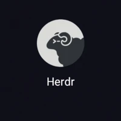 Herdr for Android

A native Android client for [herdr](https://herdr.dev) hosts: see your agents across machines, answer the blocked ones, and open any pane as a live terminal. Kotlin and Jetpack Compose. It wears the [herdr web UI](https://github.com/devswha/herdr-web-ui)'s look ("a warm terminal": amber on lamp-lit graphite or ledger paper, Lucide icons, the agents' own marks), carried over from its design tokens (MIT) into the app's own design system ([`docs/DESIGN.md`](docs/DESIGN.md)).

<table>
  <tr>
    <td align="center" width="25%">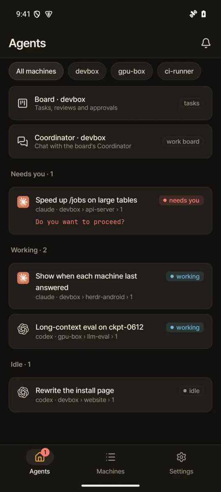<br><sub><b>Agents</b>: every agent on every machine, the blocked ones first</sub></td>
    <td align="center" width="25%">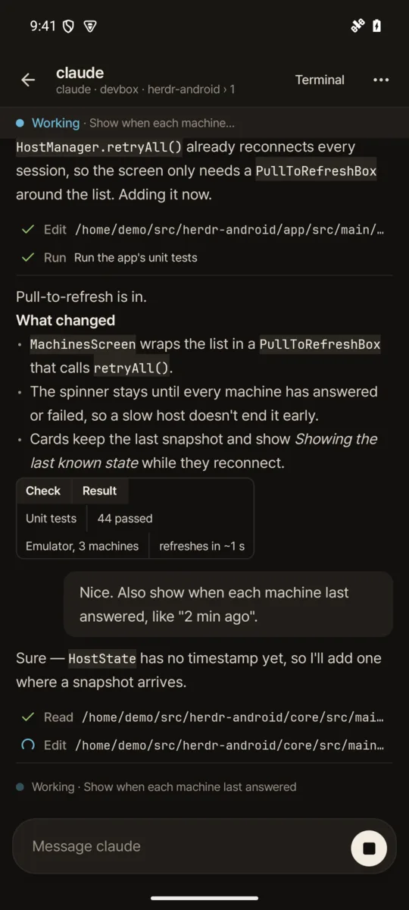<br><sub><b>Agent chat</b>: the agent's own transcript, with tool calls folded</sub></td>
    <td align="center" width="25%">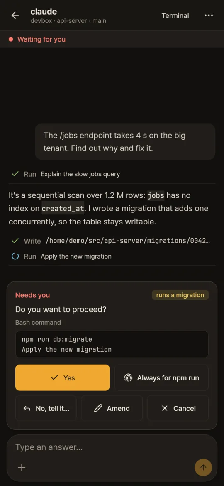<br><sub><b>Needs you</b>: answer a blocked agent with one tap</sub></td>
    <td align="center" width="25%">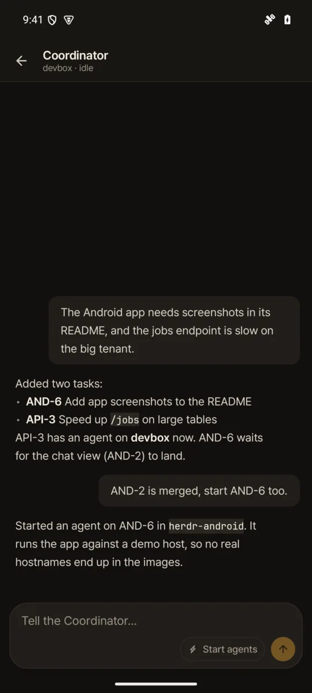<br><sub><b>Coordinator</b>: talk to the work board</sub></td>
  </tr>
  <tr>
    <td align="center">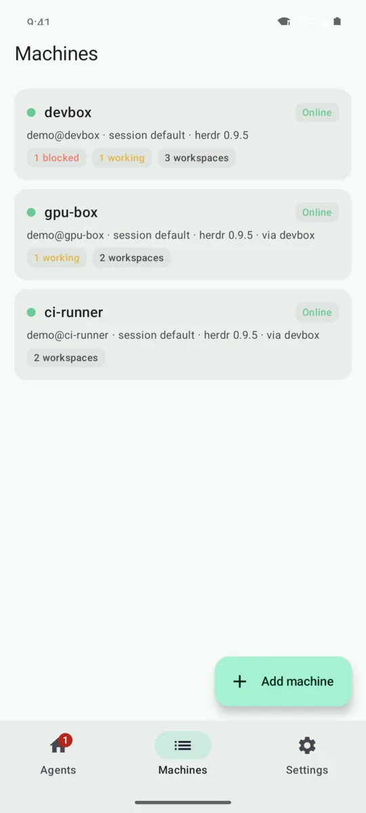<br><sub><b>Machines</b>: status per host, also through a jump host</sub></td>
    <td align="center">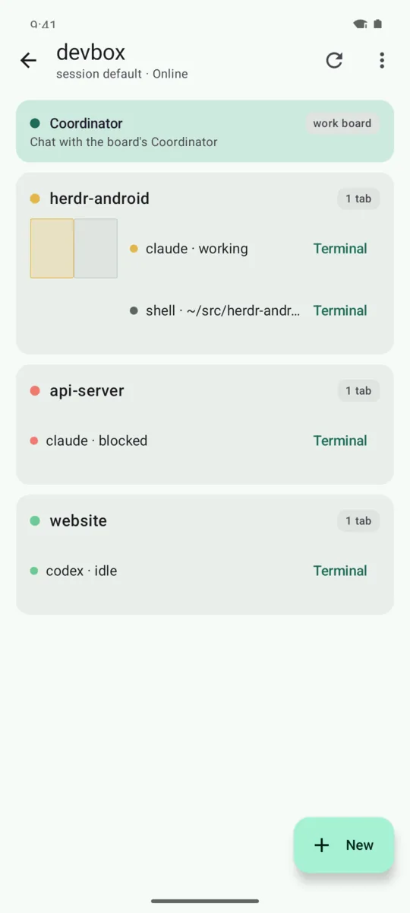<br><sub><b>A machine</b>: its workspaces, tabs and panes</sub></td>
    <td align="center">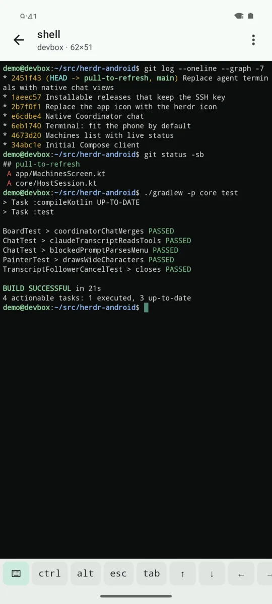<br><sub><b>Terminal</b>: any pane, live, sized to the phone</sub></td>
    <td align="center">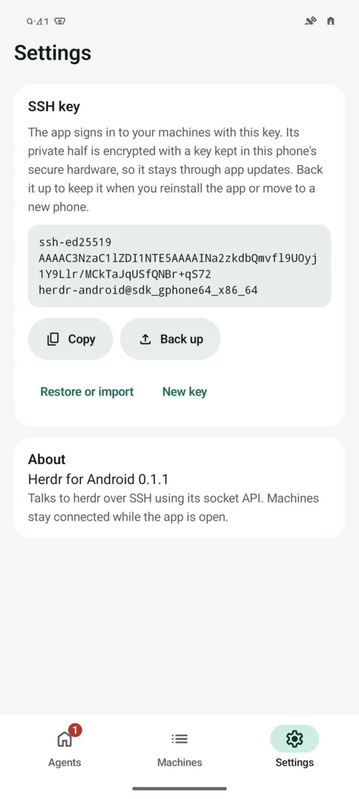<br><sub><b>Settings</b>: the SSH key, with backup and restore</sub></td>
  </tr>
  <tr>
    <td align="center">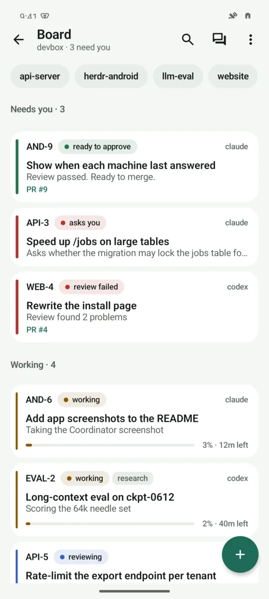<br><sub><b>Board</b>: tasks in the board's colours, the ones that need you first</sub></td>
    <td align="center">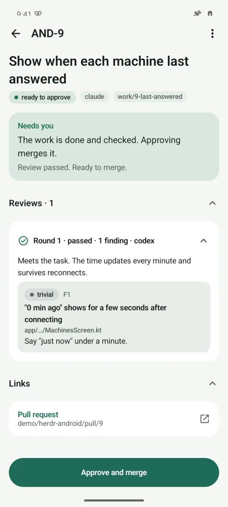<br><sub><b>A task</b>: next step, reviews, links, one tap to approve</sub></td>
    <td align="center">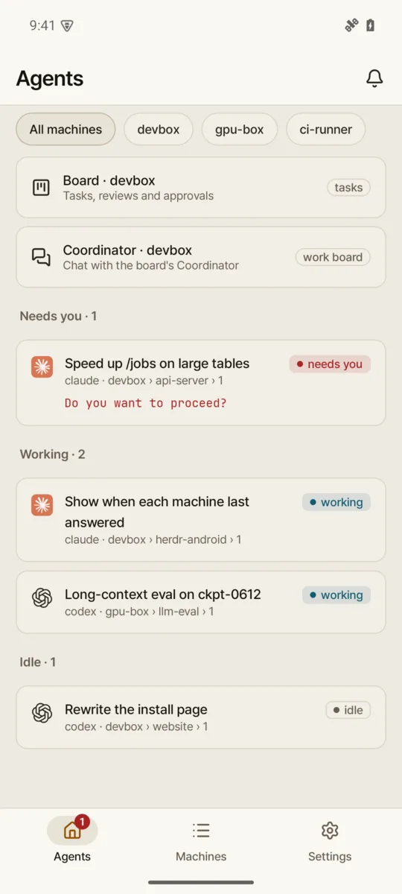<br><sub><b>Light mode</b>: follows the phone</sub></td>
    <td align="center">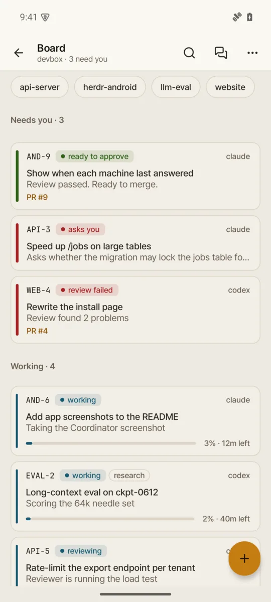<br><sub><b>Board, light</b></sub></td>
  </tr>
</table>

The screenshots come from a demo host with made-up projects (see [`docs/screenshots/demo-host`](docs/screenshots/demo-host)). The look (colours, type, icons, spacing, components) is described in [`docs/DESIGN.md`](docs/DESIGN.md); the design tokens are the herdr web UI's (MIT, by devswha), and the fonts, icons and marks are credited in [`THIRD_PARTY_NOTICES.md`](THIRD_PARTY_NOTICES.md).

## Getting the app

On your phone, open the repo's [latest release](https://github.com/makefunstuff/herdr-android/releases/latest) and tap **herdr-android.apk** (the direct link is `https://github.com/makefunstuff/herdr-android/releases/latest/download/herdr-android.apk`). Android asks you once to allow installs from your browser or file manager.

To update, do the same again: every build is signed with the same key and has a higher version code, so it installs over the app you have and keeps its machines and SSH key. No uninstall needed.

Only the default branch publishes a release (tagged `v0.1.<run number>`). Other branches and pull requests build the APK too, as the `herdr-android-<run number>` artifact on their Actions run page, without a release.

## Keeping the SSH key

The key stays through updates. An uninstall or a new phone wipes it, so back it up first: **Settings → SSH key → Back up** saves it as an OpenSSH private key protected by a passphrase you choose (`ssh-keygen -y -f herdr-android-key` reads it too). After a reinstall the app offers **Restore or import** before it makes a new key; the same button is in Settings. It also takes an existing OpenSSH (or PEM) private key, with or without a passphrase.

The app never replaces a key on its own: it only makes one when it has none and you ask for it, and **New key** asks before throwing the old one away.

## Signing key (once, for the repo owner)

Releases must all be signed with one key, or Android refuses the update. Create it once and keep a copy somewhere safe; losing it means everyone has to uninstall (and restore their SSH key backup) once.

```sh
keytool -genkeypair -keystore herdr-release.jks -alias herdr \
  -keyalg RSA -keysize 4096 -validity 10000 -dname "CN=Herdr for Android"
base64 -w0 herdr-release.jks > herdr-release.jks.b64
```

Then add these secrets under **Settings → Secrets and variables → Actions** (or with `gh secret set NAME`):

| Secret | Value |
| --- | --- |
| `HERDR_KEYSTORE_BASE64` | contents of `herdr-release.jks.b64` (`gh secret set HERDR_KEYSTORE_BASE64 < herdr-release.jks.b64`) |
| `HERDR_KEYSTORE_PASSWORD` | the keystore password |
| `HERDR_KEY_ALIAS` | `herdr` |
| `HERDR_KEY_PASSWORD` | optional: the key password, only if it differs from the keystore password (keytool uses the same one by default) |

Without these secrets, and for local builds, the APK is signed with the normal debug key and the default branch skips publishing a release (and keeps the old `apk-*` pre-releases until the first real one). To sign a local build with the real key, set `HERDR_KEYSTORE_FILE`, `HERDR_KEYSTORE_PASSWORD` and `HERDR_KEY_ALIAS` and run `./gradlew :app:assembleRelease`.

## Setting up a machine

1. Open **Settings** and copy the app's public key.
2. Add it to `~/.ssh/authorized_keys` on the machine running herdr.
3. In **Machines**, tap **Add machine** and enter `user@host[:port]`. The app pins the host key on first connect.

Machines reachable only through another one can use it as a jump host ("Connect through"). From a machine's menu, **Import herdr machines** adds the machines its herdr already knows (`herdr machine list`).

## How it talks to herdr

The app opens an SSH connection and reaches herdr's socket API through `direct-streamlocal` (falling back to `herdr remote-api-bridge`). herdr answers one request per socket connection, so each call opens a fresh channel; `events.subscribe` keeps one channel open for live updates. Terminals use `herdr terminal session control`.

## Managing from the phone

Everything that exists in a session is editable from the app, not just readable. A workspace or tab header has an actions button, and panes and agents answer to a long press: rename, focus, reorder, move, swap, zoom, clear a pane's scrollback, read what a pane is running, and ask `agent.explain` why an agent is in the state it shows. Closing a workspace, tab or pane asks first. herdr's own refusals ("There's no pane in that direction.") come back as plain sentences.

The screens follow herdr's `events.subscribe` stream, so a change made anywhere — desktop or phone — appears here. Notifications are the exception: herdr has no list of them, so the app derives them from agents finishing or blocking and shows them behind the bell in the top bar; the menu can also show a notification on the desktop running herdr.

## The work board

Next to the Coordinator chat, a machine with herdr-projects gets a **Board** screen: the task list as the board shows it (short key such as `AND-7`, title, status in the board's colours, agent, the "doing now" line, progress and minutes left, `[research]` marks, PR links), with **Needs you** (approvals, plans, pick one, errors, questions) first. Search runs the board's `--query`; chips filter by repo and machine; the menu shows archived tasks. Tap a task for its details (failure and next step, reviews with findings and severity, handovers, plan, attempts, PR and report links, limits and usage); long-press for its actions: start, tell, stop, retry, fix, review, finish, approve (and approve anyway, which shows the failure and asks for a tick), approve or send back a plan, pick an attempt, archive/restore, clear, edit title/description. **+** adds a task. It reads `herdr-projects list --json` and `details <id>` and runs the board's own CLI commands over the app's SSH connection, every few seconds while the screen is in front and not at all when backgrounded; a refused command shows the board's own reason.

## The work board's Coordinator

On a machine with [herdr-projects](https://github.com/eliasstravik/herdr-projects) (its launcher at `~/.herdr-projects/data/bin/herdr-projects`, or `herdr-projects` on the PATH), the app shows a **Coordinator** chat above that machine's agents. It reaches the board the way another machine's board does, over the same SSH connection: `herdr-projects remote list` for the conversation and where the Coordinator stands, and `herdr-projects remote dispatch` for a message, which joins the same queue as the words typed in the board's own box. So the phone and the desktop show one conversation. **Start agents**, the switch beside Send, is the board's Tab: what the Coordinator adds from that message gets an agent at once. What you type stays in the box per chat, also when you leave the app, until it is sent. **+** attaches files from the phone, in both chats: each is copied to that machine (`~/.cache/herdr-android/uploads/`) and named in the message as `@path`, which the agents read.

## Layout

- `core/`: pure Kotlin/JVM: SSH, herdr API, host sessions, terminal emulator. `./gradlew -p core test`.
- `app/`: the Android app. `ui/theme` and `ui/design` hold its look and shared components ([`docs/DESIGN.md`](docs/DESIGN.md)).
