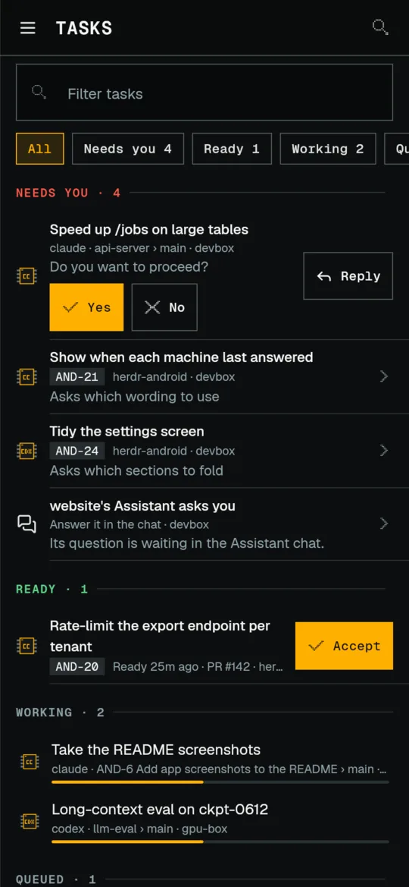
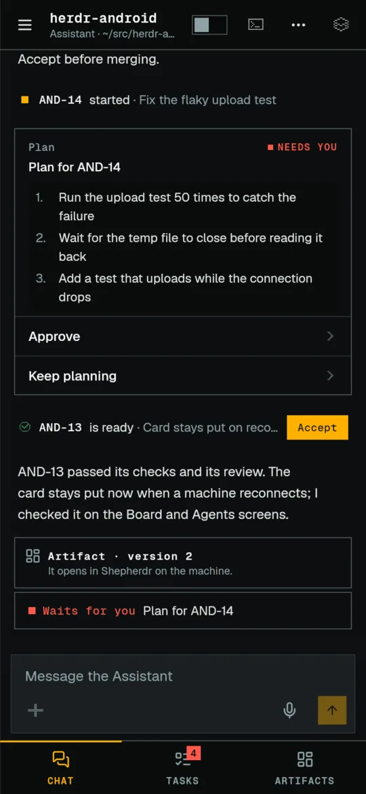
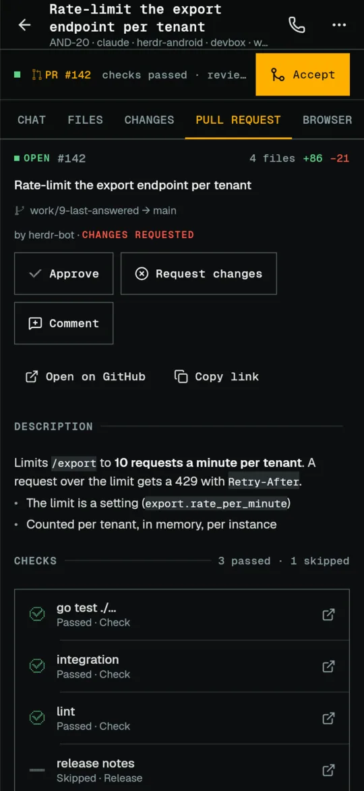
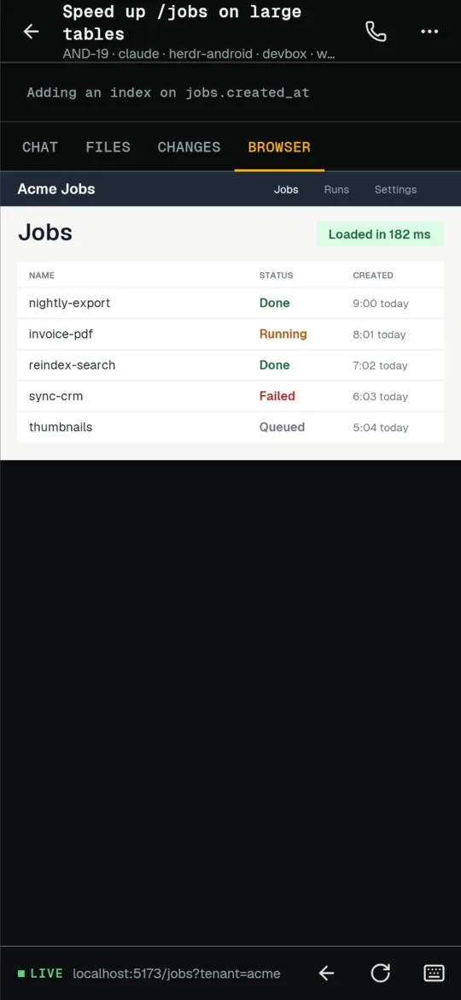
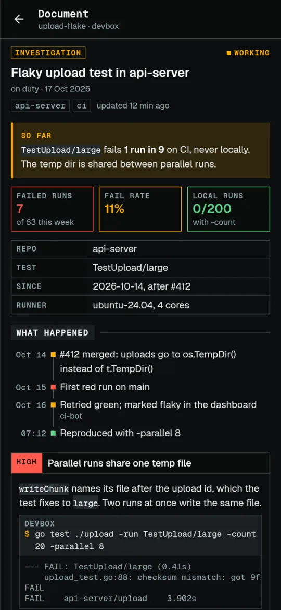
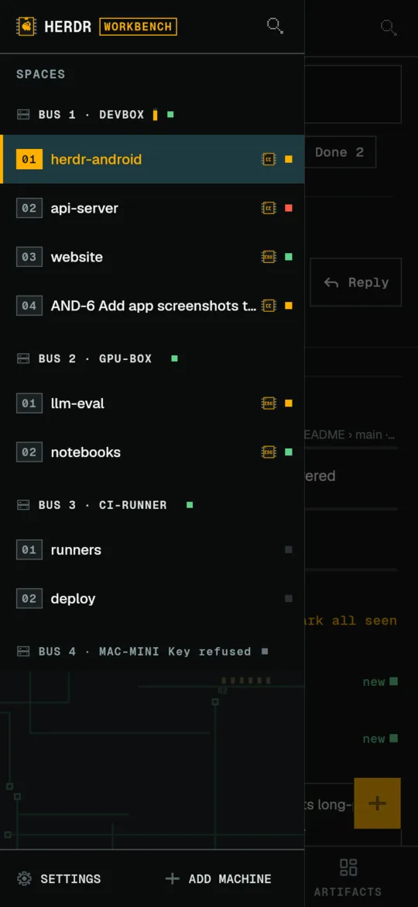
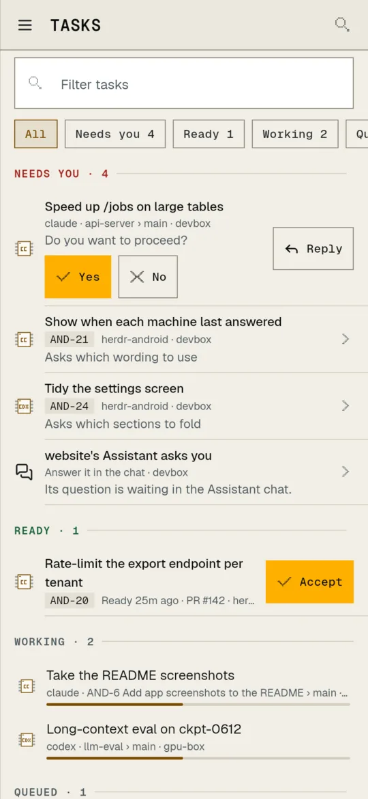

#  Herdr for Android

An Android app for people who run coding agents with [herdr](https://herdr.dev): see every agent and task on your machines, answer the ones that wait for you, and open any pane as a terminal.

<table>
  <tr>
    <td align="center" width="25%"><br><sub><b>Tasks</b>: what needs you, first</sub></td>
    <td align="center" width="25%"><br><sub><b>Assistant</b>: a space's chat</sub></td>
    <td align="center" width="25%"><br><sub><b>Agent chat</b>: its own transcript</sub></td>
    <td align="center" width="25%"><br><sub><b>Needs you</b>: answer with a tap</sub></td>
  </tr>
  <tr>
    <td align="center"><br><sub><b>A task</b>: ready to accept</sub></td>
    <td align="center"><br><sub><b>Pull request</b>: checks and review</sub></td>
    <td align="center"><br><sub><b>Browser</b>: the agent's, live</sub></td>
    <td align="center"><br><sub><b>Docs</b>: agents' write-ups</sub></td>
  </tr>
  <tr>
    <td align="center"><br><sub><b>Spaces</b>: every machine's</sub></td>
    <td align="center"><br><sub><b>A machine</b>: health and panes</sub></td>
    <td align="center"><br><sub><b>Terminal</b>: any pane</sub></td>
    <td align="center"><br><sub><b>Light mode</b></sub></td>
  </tr>
</table>

The screenshots are the app's own screens, rendered against a fake machine with made-up projects ([how](tools/ui-preview/README.md#the-readmes-screenshots)).

## Install

On your phone, open the [latest release](https://github.com/makefunstuff/herdr-android/releases/latest) and tap **herdr-android.apk**. Android asks once to allow installs from your browser.

To update, install the new APK the same way. It installs over the old one and keeps your machines and SSH key.

The app makes its own SSH key. An uninstall or a new phone loses it, so back it up: **Settings → SSH key → Back up**. After a reinstall, **Restore or import** brings it back, or takes an existing OpenSSH key.

## Set up a machine

The machine needs herdr (or the Herdr desktop app) and an SSH server the phone can reach, for example over Tailscale.

### By its code

1. On the machine, run `herdr-push pair`:
   ```sh
   curl -fsSLO https://raw.githubusercontent.com/makefunstuff/herdr-android/HEAD/host/herdr-push/herdr-push
   python3 herdr-push pair
   ```
   It shows a QR code, valid for five minutes.
2. In the app, open the spaces drawer, tap **Add machine**, then **Scan the code**. Without a scanner, **Paste the link** takes the link printed under the code.
3. Tap **Pair and add**. The phone's key goes into the machine's `~/.ssh/authorized_keys`, and the app opens the machine.

The code works only with that machine and only once. Details: [`host/herdr-push/README.md`](host/herdr-push/README.md#pairing-a-phone).

### By hand

1. In **Settings**, copy the app's public key.
2. Add it to `~/.ssh/authorized_keys` on the machine.
3. Tap **Add machine → Type the address instead** and enter `user@host[:port]`.

A machine you reach only through another one can use it as a jump host (**Connect through**).

### Windows

A Windows PC works with the Herdr desktop app's herdr-core: its agents, their chats and terminals, notifications and health. Shepherdr, simple-herdr-projects and changing the app need Linux or macOS.

Install OpenSSH Server, then make [Git for Windows](https://gitforwindows.org)' Bash its shell, in a PowerShell opened as administrator:

```powershell
New-ItemProperty -Path HKLM:\SOFTWARE\OpenSSH -Name DefaultShell -Value 'C:\Program Files\Git\bin\bash.exe' -PropertyType String -Force
```

Then pair with `python herdr-push pair`. If your user is an administrator, run it in a terminal opened as administrator. Notifications need the PC awake, you signed in, and Python 3 installed.

## What you can do

The [user guide](docs/GUIDE.md) has the details.

- [**Tasks and Needs you**](docs/GUIDE.md#tasks-and-needs-you): one list across every machine, with what waits for you on top and its answer on the row.
- [**Agent chats**](docs/GUIDE.md#agent-chats): read an agent's transcript, write to it, and answer its questions with buttons.
- [**Pictures and voice**](docs/GUIDE.md#pictures-and-voice): send photos and screenshots, dictate, or send a voice message.
- [**The Assistant and the board**](docs/GUIDE.md#the-assistant-and-the-board): talk to a space's Assistant, accept finished tasks, read artifacts, on [Shepherdr](https://github.com/eliasstravik/shepherdr) 3 or [simple-herdr-projects](https://github.com/makefunstuff/simple-herdr-projects).
- [**Start work**](docs/GUIDE.md#start-work): make a task or start an agent in a folder you pick.
- [**The terminal**](docs/GUIDE.md#the-terminal): any pane, with a key bar you can edit.
- [**Search**](docs/GUIDE.md#search): agents, tasks, machines and the words in recent chats.
- [**Code, pull requests, browser and docs**](docs/GUIDE.md#code-pull-requests-browser-and-docs): read a task's changes, review its pull request, watch its browser, read the agents' docs.
- [**Machines**](docs/GUIDE.md#machines): health, AI usage and limits, agent logins, and the spaces and panes.
- [**Notifications**](docs/GUIDE.md#notifications): with the app closed, with Approve and Reply buttons, quiet hours and Live Updates.
- [**The brief**](docs/GUIDE.md#the-brief): what happened since you last looked, also read aloud.
- [**From outside the app**](docs/GUIDE.md#from-outside-the-app): share to the Assistant, widgets, a Quick Settings tile, floating chats.
- [**Change the app from the phone**](docs/GUIDE.md#change-the-app-from-the-phone): describe a change and install the result.
- [**Settings and security**](docs/GUIDE.md#settings-and-security): fingerprint before risky actions, app lock, the SSH key.
- [**Big screens and accessibility**](docs/GUIDE.md#big-screens-and-accessibility): a sidebar on tablets, TalkBack actions, text sizes.

## Building and checks

You need JDK 17, and the Android SDK for the app itself.

```sh
./gradlew :app:assembleDebug                         # the app
./gradlew -p core test                               # core tests, no Android SDK needed
./gradlew :app:testDebugUnitTest                     # the app's JVM tests
./gradlew -p tools/ui-preview render -Ponly=agents   # screen previews, no emulator
```

UI changes are checked with the [screen previews](tools/ui-preview/README.md): the app's real screens rendered on the desktop against a fake machine. [`AGENTS.md`](AGENTS.md) says which checks to run, [`docs/ARCHITECTURE.md`](docs/ARCHITECTURE.md) how the app reaches a machine, and [`docs/RELEASING.md`](docs/RELEASING.md) how releases are signed.

## Layout

- `core/`: plain Kotlin: SSH, the herdr API, herdr-core ([`docs/HERDR_CORE.md`](docs/HERDR_CORE.md)), Shepherdr and simple-herdr-projects, transcripts, the terminal emulator, code and pull requests.
- `app/`: the Android app. Its look is in `ui/theme` and `ui/design` ([`docs/DESIGN.md`](docs/DESIGN.md)).
- `tools/ui-preview/`: the screen previews.
- `host/`: small Python scripts the app copies to a machine: [`herdr-push`](host/herdr-push/README.md) (notifications, pairing), [`herdr-usage`](host/herdr-usage/README.md) (AI usage), [`herdr-logins`](host/herdr-logins/README.md) (agent logins) and [`herdr-app-build`](host/herdr-app-build/README.md) (builds the app's updates).

## Contributing

Bug reports, ideas and pull requests are welcome. [`CONTRIBUTING.md`](CONTRIBUTING.md) says how to build, test and send a change.

## License

[MIT](LICENSE). The design tokens, icons, fonts, agent marks and the herdr logo keep their own licences, listed in [`THIRD_PARTY_NOTICES.md`](THIRD_PARTY_NOTICES.md).
